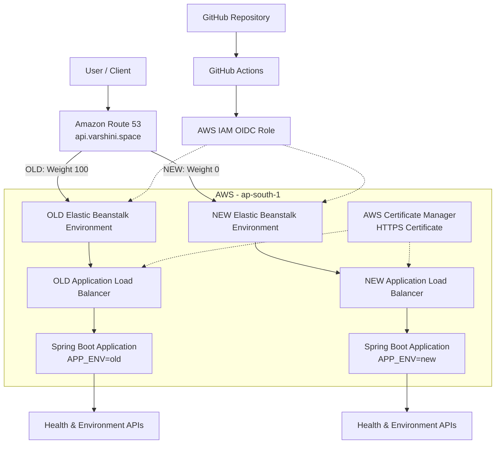
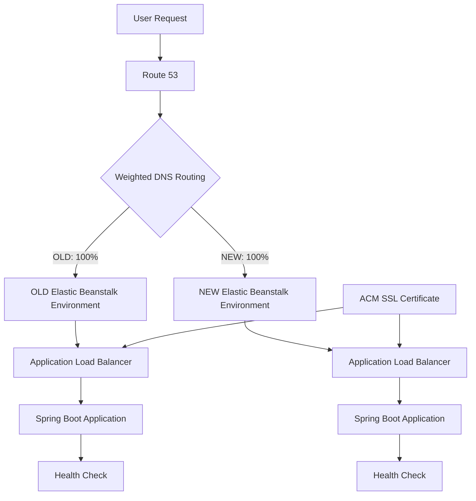
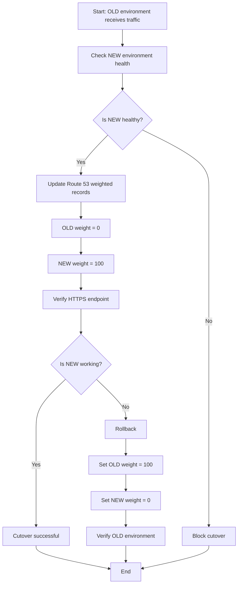
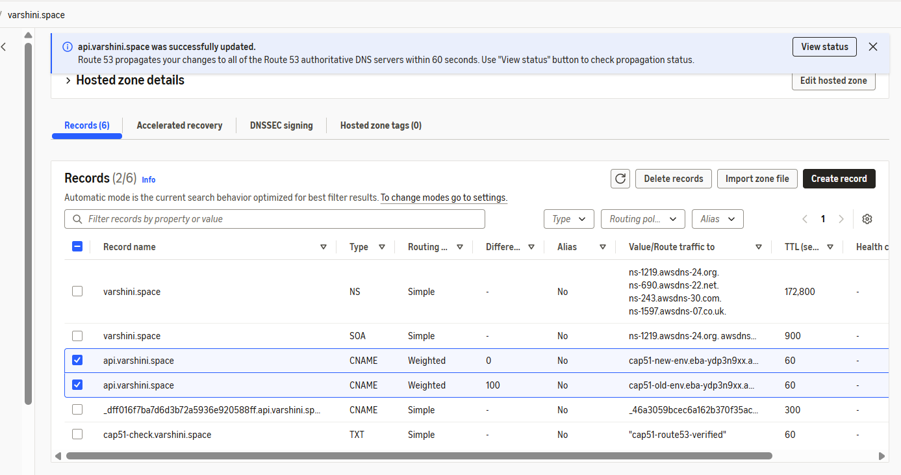
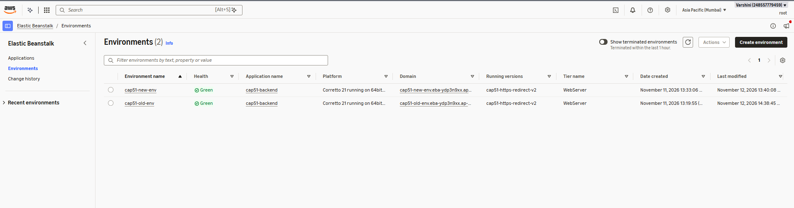
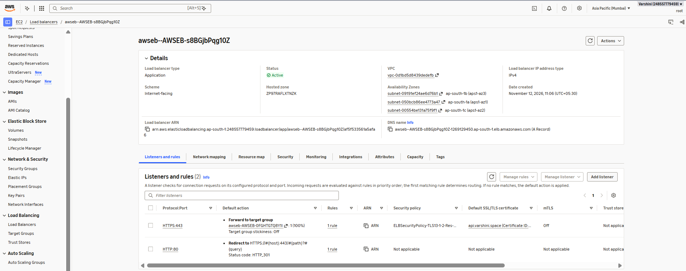
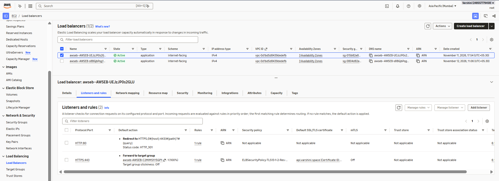
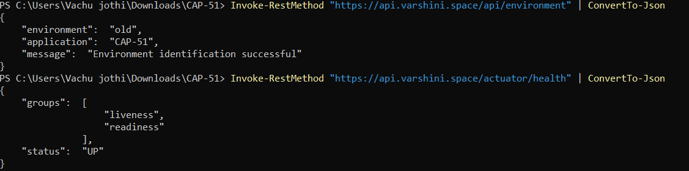
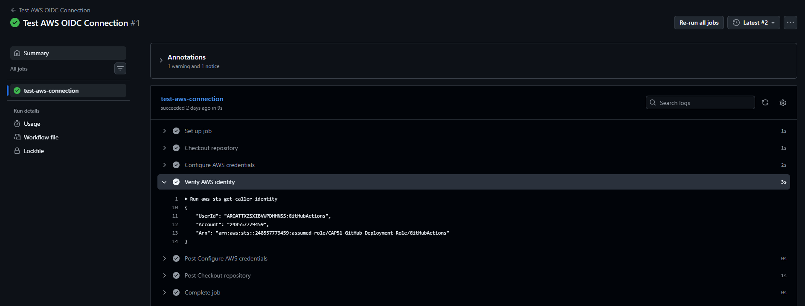

# CAP-51: Route 53 Domain Cutover & DNS Failure Diagnostic Lab

An AWS-based project that demonstrates safe DNS traffic switching, failure detection, HTTPS configuration, and rollback using Route 53, Elastic Beanstalk, React, and Spring Boot.

## Project Overview

CAP-51 demonstrates how to move application traffic between two environments without changing the application domain. It uses weighted DNS routing to control traffic distribution and supports rollback to the previous environment if the new environment encounters problems.

The project also implements HTTPS, HTTP-to-HTTPS redirection, application health checks, and DNS diagnostics.

## Architecture




## Architecture



## DNS Cutover and Rollback Workflow



## AWS Deployment Evidence

### 1. Route 53 Weighted DNS Records



### 2. Elastic Beanstalk Environments



### 3. HTTPS Configuration

**OLD Environment**



**NEW Environment**



### 4. Application Health Verification



### 5. GitHub Actions OIDC Authentication




## Technologies Used

| Category | Technologies |
|---|---|
| Cloud Platform | AWS |
| DNS Management | Amazon Route 53 |
| Application Hosting | AWS Elastic Beanstalk |
| Backend | Java 21, Spring Boot |
| Frontend | React |
| Load Balancing | Application Load Balancer |
| SSL/TLS | AWS Certificate Manager |
| CI/CD Authentication | GitHub Actions, AWS OIDC |
| Build Tool | Maven |
| Testing | PowerShell, curl, Spring Boot Actuator |

## AWS Resources

- **Route 53:** Manages the domain and weighted DNS records.
- **Elastic Beanstalk:** Hosts two independent application environments.
- **Application Load Balancer:** Distributes incoming requests to application instances.
- **AWS Certificate Manager:** Provides the SSL/TLS certificate for HTTPS.
- **IAM:** Configures secure access and GitHub Actions OIDC authentication.
- **EC2:** Runs the application instances.

## Environments

| Configuration | OLD | NEW |
|---|---|---|
| Environment | `cap51-old-env` | `cap51-new-env` |
| Application environment variable | `APP_ENV=old` | `APP_ENV=new` |
| Application port | 5000 | 5000 |
| Health endpoint | `/actuator/health` | `/actuator/health` |

Both environments run independently and can receive traffic through Route 53 weighted routing.

## Key Features

### 1. Weighted DNS Routing
- Uses Route 53 weighted records.
- Controls traffic distribution between OLD and NEW.
- Supports switching traffic between environments.

### 2. DNS Cutover and Rollback
- Switches traffic from OLD to NEW.
- Allows traffic to return to OLD if necessary.
- Demonstrates actual DNS-based cutover and rollback.

### 3. HTTPS Configuration
- Uses AWS Certificate Manager.
- Configures HTTPS listeners on port 443.
- Redirects HTTP requests on port 80 to HTTPS using HTTP 301 redirects.

### 4. Health Monitoring
- Uses Spring Boot Actuator.
- Exposes application health through `/actuator/health`.
- Checks application availability before relying on an environment.

### 5. DNS Diagnostics
- Provides DNS resolution and comparison endpoints.
- Includes DNS cache and TTL simulation.
- Maintains simulated cutover and rollback history.

### 6. Secure AWS Authentication
- Configures GitHub Actions with AWS OIDC authentication.
- Avoids storing long-lived AWS access keys in GitHub.

## Application Endpoints

| Endpoint | Purpose |
|---|---|
| `/api/health` | Application health information |
| `/api/environment` | Identifies the active environment |
| `/actuator/health` | Spring Boot health status |
| `/api/dns/diagnostics` | DNS diagnostics |
| `/api/cutover/config` | Cutover configuration |
| `/api/cutover/status` | Current simulated cutover status |
| `/api/cutover/switch` | Simulated environment switch |
| `/api/cutover/rollback` | Simulated rollback |
| `/api/cutover/history` | Simulated operation history |

**Note:** The simulated cutover APIs and actual Route 53 weighted DNS changes are separate mechanisms.

## Testing and Verification

The following tests were successfully performed:

| Test | Expected Result | Status |
|---|---|---|
| OLD environment health | UP | Passed |
| NEW environment health | UP | Passed |
| OLD environment identification | `old` | Passed |
| NEW environment identification | `new` | Passed |
| HTTP to HTTPS redirection | HTTP 301 | Passed |
| HTTPS certificate validation | Successful | Passed |
| Route 53 cutover | Traffic reaches NEW | Passed |
| Route 53 rollback | Traffic reaches OLD | Passed |
| Actuator health through domain | UP | Passed |
| GitHub Actions OIDC authentication | Successful AWS identity verification | Passed |

## Build and Run Locally

### Prerequisites
- Java 21
- Maven
- Node.js and npm
- AWS account (for cloud deployment)

### Backend

Navigate to the backend directory:

```powershell
cd backend
```

Build the application:

```powershell
.\mvnw.cmd clean package
```

Run the application:

```powershell
.\mvnw.cmd spring-boot:run
```

### Frontend

Navigate to the frontend directory:

```powershell
cd frontend
```

Install dependencies:

```powershell
npm install
```

Start the development server:

```powershell
npm run dev
```

## DNS Cutover Procedure

1. Verify that both Elastic Beanstalk environments are healthy.
2. Confirm that the NEW environment is ready to receive traffic.
3. Update Route 53 weighted records:
   - OLD weight: 0
   - NEW weight: 100
4. Allow DNS changes to propagate.
5. Verify the application response through the public domain.

## DNS Rollback Procedure

1. Identify the environment receiving traffic.
2. Verify that OLD is healthy.
3. Update Route 53 weighted records:
   - OLD weight: 100
   - NEW weight: 0
4. Allow DNS changes to propagate.
5. Verify that the public domain responds from OLD.

## Security

- HTTPS enabled using ACM.
- HTTP traffic redirected to HTTPS.
- GitHub Actions uses OIDC for AWS authentication.
- No long-lived AWS access keys are required in GitHub Actions.

## Future Improvements

- Complete automated Elastic Beanstalk deployment through GitHub Actions.
- Implement automated health-based DNS failover.
- Add comprehensive monitoring and alerting.
- Improve DNS propagation and failure reporting.
- Add automated integration tests.

## Project Status

The core application deployment, DNS cutover, rollback, HTTPS configuration, and health verification have been implemented and tested on AWS.

The automated deployment pipeline and additional documentation are ongoing improvements.

## Author
Alagu Varshini
