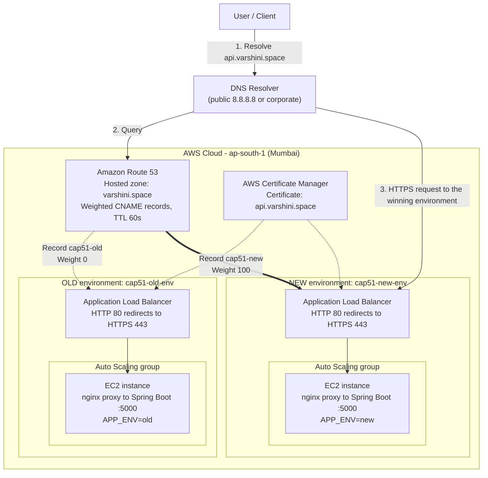
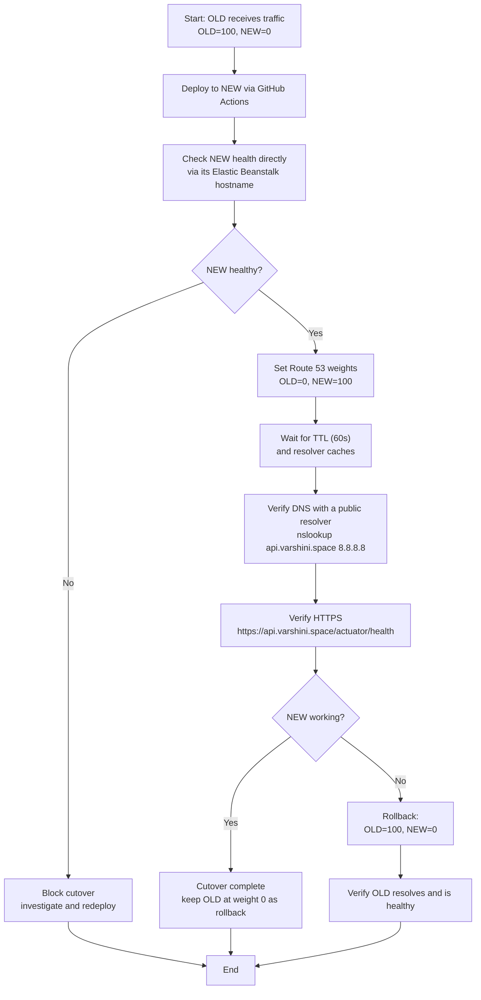
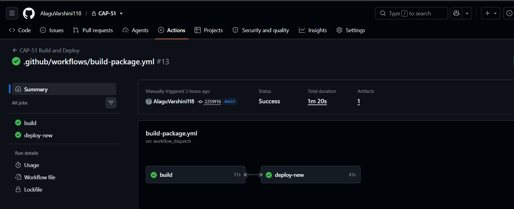
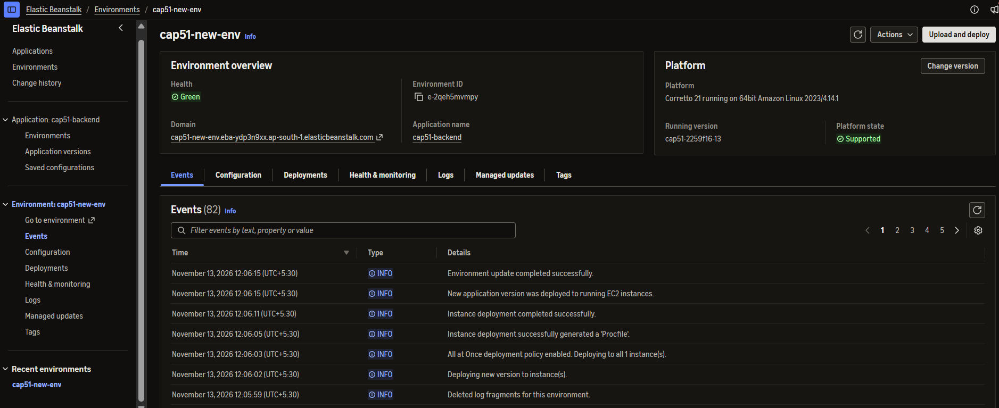
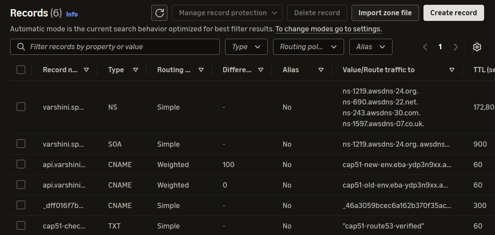
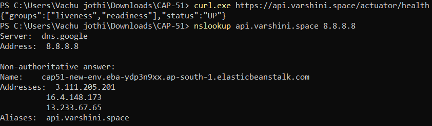

# CAP-51: Route 53 Domain Cutover & DNS Failure Diagnostic Lab

> Zero-downtime, DNS-based traffic migration between two independent AWS Elastic Beanstalk environments, with HTTPS, health verification, rollback, and automated deployment via GitHub Actions and AWS OIDC.


## Table of Contents

1. [Overview](#overview)
2. [Architecture](#architecture)
3. [CI/CD Pipeline](#cicd-pipeline)
4. [DNS Cutover and Rollback](#dns-cutover-and-rollback)
5. [Environments](#environments)
6. [Key Features](#key-features)
7. [Application Endpoints](#application-endpoints)
8. [Deployment Details](#deployment-details)
9. [IAM and Security](#iam-and-security)
10. [Testing and Verification](#testing-and-verification)
11. [Troubleshooting and Lessons Learned](#troubleshooting-and-lessons-learned)
12. [Build and Run Locally](#build-and-run-locally)
13. [Operational Runbooks](#operational-runbooks)
14. [Future Improvements](#future-improvements)
15. [Author](#author)

## Overview

CAP-51 demonstrates how to move live traffic between two independent environments **without changing the public domain** (`api.varshini.space`).

Route 53 **weighted records** decide which Elastic Beanstalk environment (OLD or NEW) receives traffic. Flipping the weights performs a cutover, and flipping them back performs a rollback. Both environments serve HTTPS using an AWS Certificate Manager (ACM) certificate, expose Spring Boot Actuator health checks, and the NEW environment is deployed automatically from GitHub using short-lived OIDC credentials.

The project also covers DNS failure diagnosis, such as comparing answers from different resolvers when a corporate DNS filter returns a sinkhole address.

## Architecture



**How a request flows**

1. The client asks a DNS resolver for `api.varshini.space`.
2. Route 53 holds two weighted CNAME records for that name: `cap51-old` (weight 0) and `cap51-new` (weight 100). Each CNAME targets the matching Elastic Beanstalk environment hostname (`cap51-<old|new>-env.eba-ydp3n9xx.ap-south-1.elasticbeanstalk.com`), which resolves to that environment's ALB.
3. The ALB terminates TLS using the ACM certificate, redirects HTTP to HTTPS with a 301, and forwards traffic to the Spring Boot application on port 5000 (through the platform's nginx proxy).
4. The ALB uses `/actuator/health` to decide whether instances are healthy.

> **Weighted routing rule:** a record with weight 0 receives no traffic as long as another record with the same name has a weight above 0. If **all** records are set to 0, Route 53 returns them with equal probability, so never set both to 0.

## CI/CD Pipeline

```mermaid
flowchart LR
    Dev["Developer<br/>git push"] --> GH["GitHub Repository<br/>AlaguVarshini118/CAP-51"]
    GH --> GA

    subgraph GA["GitHub Actions"]
        direction TB
        S1["Checkout + Set up Java 21"] --> S2["mvn test + package"]
        S2 --> S3["Create deployment ZIP"]
        S3 --> S4["Request OIDC token"]
    end

    S4 -->|"AssumeRoleWithWebIdentity"| STS["AWS STS"]
    STS -->|"Short-lived credentials"| ROLE["IAM role<br/>CAP51-GitHub-Deployment-Role"]

    ROLE --> S3B["Amazon S3<br/>elasticbeanstalk-ap-south-1-ACCOUNT_ID<br/>cap51-deployments/"]
    ROLE --> EBAPI["Elastic Beanstalk API"]

    S3B --> EBAPI
    EBAPI -->|"1. CreateApplicationVersion"| APPVER["Application version<br/>cap51-SHA-RUN"]
    EBAPI -->|"2. UpdateEnvironment"| NEW["cap51-new-env"]
    NEW -->|"3. Health check"| HC["/actuator/health"]
```



The workflow only updates the **NEW** environment. OLD remains untouched as the rollback target.

## DNS Cutover and Rollback



## Environments

| Configuration | OLD | NEW |
|---|---|---|
| Environment name | `cap51-old-env` | `cap51-new-env` |
| Route 53 record ID | `cap51-old` | `cap51-new` |
| Application variable | `APP_ENV=old` | `APP_ENV=new` |
| Application port | 5000 | 5000 |
| Health endpoint | `/actuator/health` | `/actuator/health` |
| Load balancer | Dedicated ALB | Dedicated ALB |
| DNS weight (final state) | 0 | 100 |

Each environment has its own ALB, so you can tell them apart by comparing IPs: resolve the environment hostname and the ALB hostname, and the address sets match for the ALB that belongs to that environment.

## Key Features

### Weighted DNS routing
- Route 53 weighted CNAME records control the traffic split between OLD and NEW.
- 60-second TTL so changes take effect quickly.
- Weights are relative, so gradual rollouts are possible (for example 90/10, then 50/50, then 0/100).

### Cutover and rollback
- Switch traffic OLD to NEW by changing weights only; no application or domain change.
- Roll back by restoring the previous weights.
- Verify each change by querying a public resolver.

### HTTPS
- ACM certificate for `api.varshini.space`.
- HTTPS listeners on port 443.
- HTTP port 80 redirects to HTTPS with a 301.

### Health monitoring
- Spring Boot Actuator exposes `/actuator/health`.
- The ALB and Elastic Beanstalk use it to determine instance health.
- Health is verified on NEW before any cutover.

### DNS diagnostics
- Endpoints for DNS resolution and comparison.
- DNS cache and TTL simulation.
- Simulated cutover and rollback history.

### Secure automation
- GitHub Actions authenticates to AWS with OIDC, so no long-lived access keys are stored in GitHub.
- A dedicated IAM role scopes what the pipeline can do.

## Application Endpoints

| Endpoint | Purpose |
|---|---|
| `/api/health` | Application health information |
| `/api/environment` | Identifies the application environment (`old` or `new`) |
| `/actuator/health` | Spring Boot health status |
| `/api/dns/diagnostics` | DNS diagnostics |
| `/api/cutover/config` | Cutover configuration |
| `/api/cutover/status` | Current simulated cutover status |
| `/api/cutover/switch` | Simulated environment switch |
| `/api/cutover/rollback` | Simulated rollback |
| `/api/cutover/history` | Simulated operation history |

> **Note:** The `/api/cutover/*` endpoints are a **simulation** kept in memory and reset when the application restarts. They do not change DNS. Real traffic routing is controlled only by the Route 53 weighted records.

## Deployment Details

| Configuration | Value |
|---|---|
| GitHub repository | `AlaguVarshini118/CAP-51` |
| AWS region | `ap-south-1` |
| Elastic Beanstalk application | `cap51-backend` |
| Deployment target | `cap51-new-env` |
| Authentication | GitHub OIDC |
| IAM role | `CAP51-GitHub-Deployment-Role` |
| S3 bucket | `elasticbeanstalk-ap-south-1-<account-id>` |
| S3 key pattern | `cap51-deployments/cap51-<short-sha>-<run-number>.zip` |
| Version label pattern | `cap51-<short-sha>-<run-number>` |
| Example deployed version | `cap51-2259f16-12` |

### Workflow steps

1. Checkout the repository.
2. Set up Java 21.
3. Run Maven tests and package the application.
4. Create the deployment ZIP.
5. Upload the ZIP as a GitHub Actions artifact.
6. Authenticate to AWS through OIDC.
7. Upload the ZIP to S3.
8. Create an Elastic Beanstalk application version.
9. Update `cap51-new-env` with the new version.
10. Wait for the update and verify environment health.

## IAM and Security

- HTTPS enforced through ACM, with HTTP redirected to HTTPS.
- GitHub Actions uses OIDC and short-lived credentials; no static AWS keys.
- The deployment role trusts only the GitHub OIDC provider and should be restricted to this repository and branch in its trust policy.
- Security groups allow inbound 80 and 443 on the ALBs.

### Permissions the deployment role needs

`UpdateEnvironment` does more than call the Elastic Beanstalk API. Elastic Beanstalk uses the caller's credentials to read and write objects in its own S3 bucket, so the role needs:

| Area | Permission | Scope |
|---|---|---|
| Upload package | `s3:PutObject`, `s3:GetObject` | `cap51-deployments/*` in the EB bucket |
| Extensions | `s3:GetObject`, `s3:PutObject` | `resources/environments/*/_runtime/_embedded_extensions/cap51-backend/*` |
| Bucket access | `s3:ListBucket`, `s3:GetBucketLocation` | The EB bucket itself (no `/*`) |
| Versions | `elasticbeanstalk:CreateApplicationVersion`, `DescribeApplicationVersions` | Application `cap51-backend` |
| Deploy | `elasticbeanstalk:UpdateEnvironment` | `cap51-new-env` (and OLD if needed) |
| Read | `elasticbeanstalk:DescribeEnvironments` | `*` |

If a deployment fails with a new `AccessDenied` or `InsufficientPrivilegesException`, the error names the missing resource; add only that permission. Avoid leaving broad managed policies such as `AdministratorAccess-AWSElasticBeanstalk` attached once the least-privilege policy works.

## Testing and Verification

| Test | Result |
|---|---|
| OLD environment health | Passed |
| NEW environment health | Passed |
| OLD environment identification | Passed |
| NEW environment identification | Passed |
| HTTP-to-HTTPS redirection | Passed |
| HTTPS certificate validation | Passed |
| GitHub Actions OIDC authentication | Passed |
| Automated application deployment | Passed |
| Elastic Beanstalk NEW deployment | Passed |
| Route 53 cutover to NEW | Passed |
| Route 53 rollback to OLD | Passed |
| OLD environment direct HTTPS health check | Passed |
| NEW environment public HTTPS health check | Passed |
| Final DNS resolution to NEW | Passed |

### Cutover verification

```text
$ nslookup api.varshini.space 8.8.8.8
api.varshini.space -> cap51-new-env.eba-ydp3n9xx.ap-south-1.elasticbeanstalk.com
```

### Rollback verification

```text
$ nslookup api.varshini.space 8.8.8.8
api.varshini.space -> cap51-old-env.eba-ydp3n9xx.ap-south-1.elasticbeanstalk.com
```

The OLD environment returned HTTP 200 with status `UP`.

### Final configuration

| Environment | Weight |
|---|---:|
| OLD | 0 |
| NEW | 100 |

### Public health check

`https://api.varshini.space/actuator/health`

```json
{
  "status": "UP"
}
```

## AWS Deployment Evidence

### Route 53 weighted DNS records


### Elastic Beanstalk environments


### HTTPS configuration

**OLD**


**NEW**


### Health verification


### GitHub Actions OIDC authentication


### Final deployment verification









## Troubleshooting and Lessons Learned

Real issues hit during this project and how each was diagnosed.

| Symptom | Root cause | Fix |
|---|---|---|
| `InsufficientPrivilegesException` on `update-environment`, naming an S3 key under `_embedded_extensions` | The OIDC role could not read/write Elastic Beanstalk's own S3 paths, which `UpdateEnvironment` uses on the caller's behalf | Grant the S3 permissions listed in [IAM and Security](#iam-and-security) |
| `HeadObject` "Not found" | The ZIP key being read did not match the key that was uploaded, or the upload step did not run | Verify with `aws s3 ls`, and make sure the version label and S3 key are identical across all steps |
| Browser shows "Not secure" on the `*.elasticbeanstalk.com` URL | The ACM certificate covers `api.varshini.space`, not the default AWS hostname, so the name does not match | Test using `https://api.varshini.space` |
| `ERR_CONNECTION_TIMED_OUT` on the custom domain | The corporate DNS resolver returned a Palo Alto sinkhole address instead of the real answer | Compare resolvers: `nslookup api.varshini.space 8.8.8.8`; test from a non-corporate network |
| Public DNS still returned the OLD environment | Both weighted records existed and the NEW record had weight 0 | Set NEW to 100 and OLD to 0 |
| TLS handshake reset from a corporate machine | The firewall inspects the hostname and blocks the domain category | Test from a personal network, or request recategorization from IT |

### Useful diagnostic commands

```powershell
# Compare what different resolvers say
nslookup api.varshini.space
nslookup api.varshini.space 8.8.8.8

# Find which nameservers host the zone
nslookup -type=NS varshini.space 8.8.8.8

# Test a specific IP while sending the correct hostname
curl.exe -v --resolve api.varshini.space:443:<ALB-IP> https://api.varshini.space/actuator/health
```

```bash
# Confirm the artifact exists where Elastic Beanstalk expects it
aws s3 ls s3://elasticbeanstalk-ap-south-1-<account-id>/cap51-deployments/ --region ap-south-1

# Confirm which identity the pipeline is using
aws sts get-caller-identity
```

## Build and Run Locally

### Prerequisites
- Java 21
- Maven
- Node.js and npm
- AWS account (for cloud deployment)

### Backend

```powershell
cd backend
.\mvnw.cmd clean package
.\mvnw.cmd spring-boot:run
```

### Frontend

```powershell
cd frontend
npm install
npm run dev
```

## Operational Runbooks

### Cutover (OLD to NEW)

1. Confirm both environments are healthy in Elastic Beanstalk.
2. Check NEW directly: `https://cap51-new-env.eba-ydp3n9xx.ap-south-1.elasticbeanstalk.com/actuator/health` (a certificate-name warning is expected on this hostname).
3. In Route 53, set `cap51-new` weight to `100` and `cap51-old` weight to `0`.
4. Wait at least one TTL (60 seconds).
5. Verify: `nslookup api.varshini.space 8.8.8.8`.
6. Verify: `https://api.varshini.space/actuator/health` returns `{"status":"UP"}`.

### Rollback (NEW to OLD)

1. Confirm OLD is healthy.
2. In Route 53, set `cap51-old` weight to `100` and `cap51-new` weight to `0`.
3. Wait at least one TTL (60 seconds).
4. Verify public DNS resolves to `cap51-old-env`.
5. Verify OLD health through the public domain.

Keep the inactive record at weight 0 instead of deleting it, so either direction is a single edit.

## Future Improvements

- Route 53 health checks with automated DNS failover.
- CloudWatch dashboards and alarms for ALB 5xx rates and target health.
- Automated integration and end-to-end tests in the pipeline.
- Gradual traffic shifting (for example 10%, 50%, 100%) with automatic rollback on failed health checks.
- Infrastructure as code (Terraform or CloudFormation) for Route 53, ALBs, and IAM.
- Restrict the OIDC trust policy to the specific repository and branch, and keep the permissions policy least-privilege.

## Author

**Alagu Varshini**
